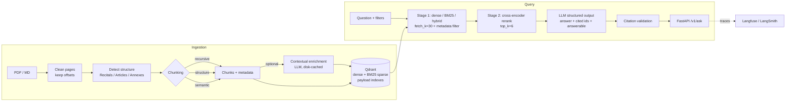

# Regulatory RAG with a Rigorous Evaluation Harness


A production-grade Retrieval-Augmented Generation assistant over the **EU AI Act (Regulation (EU) 2024/1689)**,
built on the LangChain v1 ecosystem, with an evaluation harness that measures every design decision.

Most RAG portfolio projects stop at "it answers questions." This one answers **"how do you know it works,
and which components actually matter?"**, with an ablation table and statistical significance tests.

## Architecture



| Concern | Implementation |
|---|---|
| Parsing | PyMuPDF, page-level cleaning of Official Journal headers, offset to page mapping |
| Chunking | `recursive` baseline, `structure` (never crosses articles, splits on legal paragraphs, adds section header), `semantic` (embedding breakpoints) |
| Contextual retrieval | LLM-written context prepended per chunk, cached by content hash |
| Hybrid search | Qdrant dense (`text-embedding-3-small`) + sparse BM25 (`Qdrant/bm25` via FastEmbed), server-side fusion |
| Reranking | `BAAI/bge-reranker-v2-m3` cross-encoder (local) or Cohere Rerank |
| Metadata filtering | Whitelisted fields (`ref`, `chapter`, `section_type`, `doc_id`) with Qdrant payload indexes |
| Citations | Structured output; citation ids validated against the actual sources; hallucinated markers stripped |
| Safety | Sources treated as untrusted data in the prompt; explicit abstention when not answerable |
| Serving | FastAPI, request IDs, timeouts, liveness/readiness probes, Docker |
| Observability | Langfuse callback handler (or LangSmith via env vars), token accounting per request |
| Evaluation | Section-level retrieval metrics, Ragas judge metrics, abstention metrics, paired bootstrap CIs |
| CI | Unit tests + smoke eval with a quality gate on every PR, full ablation nightly |

## Quickstart

```bash
cp .env.example .env              # add OPENAI_API_KEY (+ Langfuse keys for tracing)
make install                      # uv sync --extra rerank --extra eval --extra dev
make up                           # Qdrant in Docker
make data                         # downloads the EU AI Act PDF into data/raw/
uv run ragsys ingest --chunking structure
uv run ragsys ask "Can employers use emotion recognition on staff?"
uv run ragsys ask "What documentation must providers keep?" --chapter "Chapter III"
uv run ragsys serve               # http://localhost:8000/docs
```

```bash
curl -s localhost:8000/v1/ask -H 'content-type: application/json' \
  -d '{"question": "What are the fines for prohibited practices?", "filters": {"ref": "Article 99"}}'
```

If EUR-Lex blocks the scripted download, download the PDF manually from the EUR-Lex page for Regulation
2024/1689 and save it as `data/raw/eu_ai_act_2024_1689.pdf`. Any other PDFs or Markdown files you add to
`data/raw/` are indexed too (unstructured documents fall back to a single section).

## Building the evaluation set (the most important step)

Scores are only as trustworthy as the questions. Target 120 to 150 verified examples.

```bash
uv run ragsys eval generate   # ~120 single-section + 20 multi-hop + 15 unanswerable candidates
uv run ragsys eval review     # accept / edit / reject each candidate against its evidence
```

Then hand-write at least 30 questions yourself (set `"source": "human"`), especially the hard kinds:
questions spanning two articles, questions using everyday words instead of legal vocabulary, and questions
the Act does not answer. `data/eval/testset.example.jsonl` shows the schema.

Design choices worth explaining in an interview:

* **Gold labels are sections ("Article 6"), not chunk IDs.** Chunk IDs change when chunking changes, which
  would make a chunking ablation impossible to score fairly. Section labels stay valid across all variants.
* **Synthetic questions inflate retrieval scores** because they reuse the chunk's wording. The generator
  prompt forbids copying phrases, and the report breaks results down by `question_type`.
* **Unanswerable questions measure abstention**: `correct_abstention_rate` (says "not covered" when it
  should) and `false_abstention_rate` (refuses when the answer was available) are tracked separately.
* **Retrieval metrics are deterministic** (no judge, no cost, no noise). LLM-judge metrics (faithfulness,
  answer relevancy, context recall, factual correctness) come from Ragas with a judge model stronger than
  or equal to the generator, at temperature 0.

## Running the ablation study

```bash
uv run ragsys ingest --all                  # builds every index variant in configs/ablations.yaml
uv run ragsys eval ablate                   # retrieval metrics only (fast, nearly free)
uv run ragsys eval ablate --with-generation # + answers and LLM-judge metrics
```

`results/ablation.md` contains two tables:

1. **Metrics per configuration.** Each row changes one component relative to the previous one, so
   every delta is attributable.
2. **Paired bootstrap vs. baseline.** The mean per-question difference with a 95% confidence interval.
   With ~150 questions, a +2 point change in recall is frequently noise; bold entries are the ones whose
   interval excludes zero.

Report what you find, including negative results. Independent benchmarks have found that reranking
sometimes adds only marginal gains at a real latency cost, and "reranking didn't help on this corpus, so
I dropped it and saved 400 ms p50" is a stronger interview story than an unexplained big number.

After the study, copy the winning configuration into `configs/pipeline.yaml`; that is what the API serves
and what CI gates.

## Results

Dataset: `data/eval/testset.jsonl` (sha `747b6077e326`, n=150). LLM `openai:gpt-5-mini`, judge `openai:gpt-4.1`, embeddings `openai:text-embedding-3-small`. Scores in %.

| Experiment | Chunking | Ctx | Retrieval | Reranker | Hit@5 | Recall@5 | MRR | Faithfulness | Answer rel. | Ctx recall | Factual corr. | Citation hit | Correct abstain | False abstain | p50 ms |
|---|---|---|---|---|---|---|---|---|---|---|---|---|---|---|---|
| A_dense_recursive | recursive | no | dense | none | 89.6 | 86.3 | 74.5 | 95.7 | 72.3 | 86.3 | 24.4 | 92.5 | 73.3 | 11.1 | 10,165 |
| F_hybrid_structure_rerank | structure | no | hybrid | cross_encoder | 98.5 | 94.8 | 91.6 | 97.6 | 75.7 | 94.2 | 25.1 | 100.0 | 80.0 | 4.4 | 21,500 |
| G_full_contextual | structure | yes | hybrid | cross_encoder | 100.0 | 97.4 | 94.3 | 97.7 | 78.7 | 99.3 | 28.0 | 100.0 | 73.3 | 1.5 | 28,850 |

## Paired bootstrap vs baseline (`A_dense_recursive`)

Delta in percentage points with 95% CI over per-question scores. **Bold** = CI excludes zero.

| Experiment | Recall@5 | MRR | Faithfulness | Factual corr. |
|---|---|---|---|---|
| F_hybrid_structure_rerank | **+8.5 [+4.1, +13.7]** | **+17.1 [+11.4, +23.5]** | +1.9 [-0.5, +4.4] | +0.7 [-4.2, +5.6] |
| G_full_contextual | **+11.1 [+6.7, +16.3]** | **+19.8 [+13.5, +26.3]** | +1.9 [-0.8, +4.5] | +3.6 [-1.2, +8.4] |

Production configuration (`configs/pipeline.yaml`): G_full_contextual

## Quality gate

`configs/thresholds.yaml` defines minimums (e.g. `recall@5`, `faithfulness`) and maximums
(`false_abstention_rate`, `latency_ms_p95`). Every PR runs a stratified 30-question smoke eval and fails if a
threshold is violated; the report is posted as a PR comment. Set thresholds from a measured baseline minus
a noise margin. Judge-based metrics fluctuate between runs.

## Project layout

```
src/ragsys/
  config.py              Settings (env) + PipelineConfig (one ablation row)
  models.py              init_chat_model / init_embeddings factories
  ingest/                loaders, structure parser, chunkers, contextual enrichment, indexing
  retrieval/             Qdrant store, filters, rerankers, two-stage retriever
  generation/            prompt, structured output, citation validation, pipeline
  api/app.py             FastAPI service
  evaluation/            dataset, generation + review, metrics, Ragas, bootstrap, runner, reports, gate
configs/                 pipeline.yaml, ablations.yaml, thresholds.yaml
tests/                   structure parsing, chunk offsets, metrics, bootstrap, citations, gate
```

## Limitations and next steps

* Tables in annexes are extracted as plain text; Docling (`langchain-docling`) would preserve structure.
* No query rewriting or multi-query retrieval yet, a natural next ablation row.
* In-process cross-encoder; at scale, serve it separately (e.g. Text Embeddings Inference).
* No auth or rate limiting on the API; put it behind a gateway.
* The corpus is the 2024 text of Regulation (EU) 2024/1689. The Digital Omnibus (Regulation (EU)
  2026/1744, in force since 27 July 2026) moved some application dates; index the consolidated
  text to cover them.
* Evaluation is English-only; the Act exists in all EU languages, which makes a multilingual retrieval
  study an easy extension.
